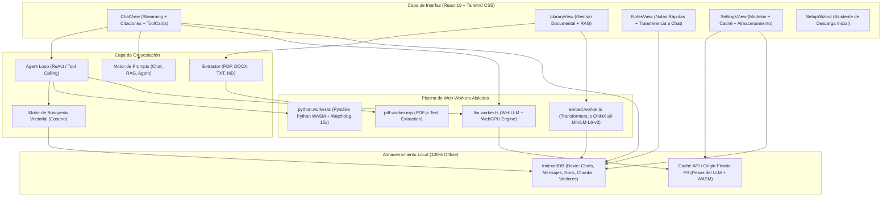
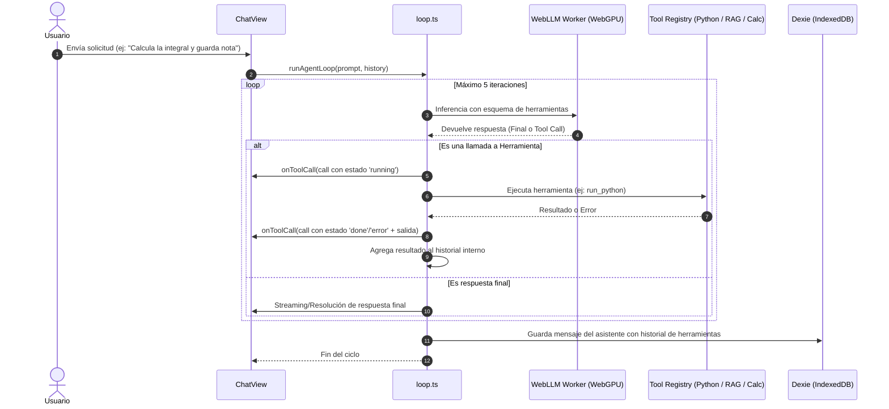

# Arquitectura de Jinx (100% Offline AI Agent)

Este documento detalla la arquitectura técnica de **Jinx**, diseñado específicamente para el Hackathon **Hack47 OFFGRID**.

---

## 1. Principios de Diseño Off-Grid

1. **Cero Dependencia de Red:** La aplicación no realiza peticiones HTTP a ningún servidor una vez que los recursos iniciales y los pesos del modelo están en caché.
2. **Hilo Principal Siempre Fluido:** Ninguna computación pesada (inferencia LLM, cálculo de embeddings, parsing de PDFs ni ejecución de Python) ocurre en el hilo principal de la UI. Todo corre en Web Workers aislados.
3. **Persistencia Local y Privada:** Toda la información (historial de chats, documentos subidos, fragmentos vectorizados, notas y ajustes) se almacena en IndexedDB mediante Dexie.js.

---

## 2. Diagrama General de Componentes



---

## 3. Flujo del Ciclo Autónomo del Agente (Agent Loop)

Cuando el usuario activa el **Modo Agente**, la interacción sigue un ciclo de ReAct controlado de hasta 5 pasos:



---

## 4. Pipeline de RAG (Retrieval-Augmented Generation)

```mermaid
flowchart LR
    A[Documento: PDF/DOCX/TXT/MD] --> B[Extractor Local]
    B --> C[Chunker: 500 tokens + 80 overlap]
    C --> D[embed.worker.ts: all-MiniLM-L6-v2 ONNX]
    D --> E[(Dexie DB: doc_chunks + Float32Array)]
    
    Q[Pregunta del Usuario] --> F[embed.worker.ts]
    F --> G[Vector de Consulta]
    G & E --> H[search.ts: Cosine Similarity Bruta]
    H --> I[Top-K Chunks Relevantes]
    I --> J[Prompt RAG con Formato de Citación]
    J --> K[WebLLM Worker]
    K --> L[Respuesta con Badges [1], [2] Clicables]
```

### Citaciones Interactivas
Cada chunk incluye metadatos:
- `documentId`: ID único en base de datos.
- `documentName`: Nombre del archivo.
- `page`: Número de página específico (para PDFs).
- `snippet`: Texto exacto recuperado.

La interfaz renderiza badges con popovers interactivos que permiten al usuario verificar la fuente original con un clic sin abandonar la conversación.

---

## 5. Medidas de Seguridad y Resiliencia

1. **Watchdog de Pyodide (15 Segundos):** Si un script de Python ejecuta un bucle infinito (`while True: pass`) o excede 15 segundos, el worker se termina forzosamente (`worker.terminate()`), se crea una nueva instancia limpia y se informa el error al agente sin colgar la aplicación.
2. **Parser Matemático Seguro:** El evaluador de expresiones matemáticas utiliza descenso recursivo de tokens gramaticales. Prohibido estrictamente el uso de `eval()` o `Function()`.
3. **Medical Disclaimer de Emergencias:** Todas las consultas al pack de emergencia inyectan en el prompt la instrucción mandatoria de incluir el aviso de seguridad: *"No sustituye atención médica profesional."*
4. **Almacenamiento Persistente:** En navegadores que soportan `navigator.storage.persist()`, NODO solicita permisos para evitar que el navegador elimine los pesos del modelo (1-2 GB) bajo presión de memoria.
